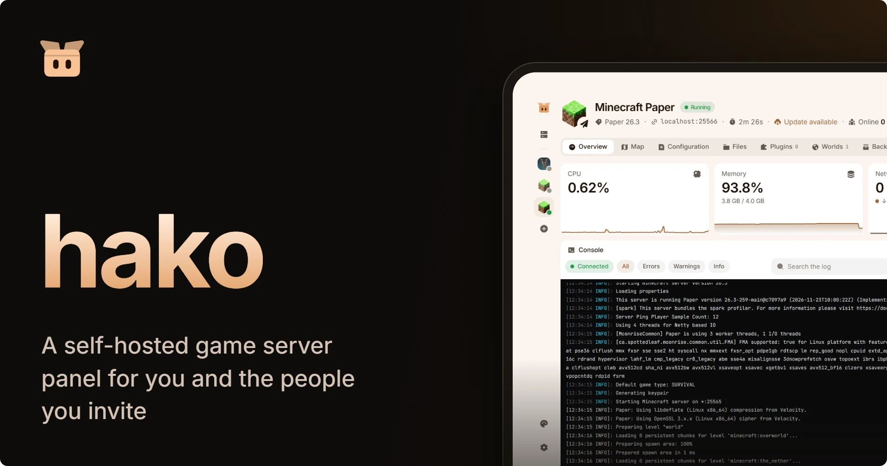

<div align="center">



[](LICENSE)
[](https://github.com/anivire/hako/commits/main)
[](#getting-started)
[](#features)

[Features](#features) · [Getting started](#getting-started) · [Games](#games) · [Your own games](docs/games.md) · [Configuration](#configuration)

</div>

## Features

hako (箱, "box") runs each game server in its own Docker container and gives you and your friends one place to start them, read the console, change settings and install mods. Every game is a small JSON template, so any game with a Docker image can be added without touching the code.

**Run**
- Start, stop, restart and force stop. Game servers keep running while the panel restarts or updates.
- Live console with command history, log filters and search, and CPU, memory, network and storage charts.
- Players online right now, read from the server log, with Minecraft heads.
- The game version is detected from the log and shown next to the server name.

**Configure**
- A settings form for each game instead of raw files: `server.properties`, Factorio and Terraria configs, BepInEx mod configs, with descriptions, defaults and markers on changed values.
- Minecraft players: admins, bans and the allowlist, plus everyone who has joined, with kick, ban and op in one click. Changes go through the console while the server runs.
- File manager with an editor, upload and download.
- Backups of the server folder: the world is saved first while the server runs, the last N are kept, restore and download in one click.
- Worlds: several per server, switch between them, download one as a `.zip` or upload your own.
- Schedules: cron tasks made of steps, such as a message to players, a pause, a console command, a backup and a restart.

**Mods**
- Minecraft mods and plugins from Modrinth: search, install with required dependencies, turn off or remove.
- Modpacks from Modrinth and CurseForge, with versions loaded from the source.
- Valheim mods from Thunderstore and Terraria (tModLoader) mods from the Steam Workshop.

**Together**
- Users join by invite link; there is no open registration.
- Invite people to a single server and pick what they can do there: console, power, files, config, mods, settings.
- Admin panel with users, invites and the status of every external provider.

**Make it yours**
- Light and dark themes, colour presets, and navigation on any side of the screen with the servers you pick, in your order.
- Interface in Russian and English.

## Games

| Game | Image | What you can run |
|---|---|---|
| Minecraft: Java Edition | [itzg/minecraft-server](https://github.com/itzg/docker-minecraft-server) | Vanilla, Paper, Purpur, Fabric, Quilt, Forge, NeoForge, modpacks from Modrinth and CurseForge |
| Minecraft: Bedrock Edition | [itzg/minecraft-bedrock-server](https://github.com/itzg/docker-minecraft-bedrock-server) | Latest or Preview Bedrock Dedicated Server |
| Factorio | [factoriotools/factorio](https://github.com/factoriotools/factorio-docker) | Stable or experimental, with or without Space Age |
| Terraria | [ryshe/terraria](https://github.com/ryshe/terraria), [jacobsmile/tmodloader1.4](https://github.com/JACOBSMILE/tmodloader1.4) | Vanilla, TShock or tModLoader with Workshop mods |
| Valheim | [community-valheim-tools/valheim-server](https://github.com/community-valheim-tools/valheim-server-docker) | Vanilla or BepInEx with Thunderstore mods |
| Project Zomboid | [danixu86/project-zomboid-dedicated-server](https://github.com/Danixu/project-zomboid-server-docker) | Build 42 with Workshop mods by id |
| Don't Starve Together | [superjump22/dontstarvetogether](https://github.com/superjump22/dontstarve-server-docker) | Overworld shard, needs a Klei cluster token |
| Core Keeper | [escaping/core-keeper-dedicated](https://github.com/escapingnetwork/core-keeper-dedicated) | Steam relay with a Game ID or direct connect |
| Satisfactory | [wolveix/satisfactory-server](https://github.com/wolveix/satisfactory-server) | Stable or experimental |

To add another game, drop a JSON template into the games folder. [docs/games.md](docs/games.md) describes the format.

## Getting started

hako needs Docker on the host and access to its socket.

```bash
git clone https://github.com/anivire/hako.git
cd hako
sudo mkdir -p /srv/hako/servers /srv/hako/games
cp .env.example .env    # set APP_URL, and ADMIN_USERNAME and ADMIN_PASSWORD if you want
docker compose up -d --build
```

Open `APP_URL` and sign in. Without `ADMIN_USERNAME` and `ADMIN_PASSWORD` the log prints a one-time link to create the admin account. Invite people under **Admin → Invites**, or invite them to a single server on its **Access** tab.

Server files are stored in `/srv/hako/servers`. This folder must be mounted at the same path inside the hako container (as in `docker-compose.yml`), because Docker resolves the game containers' folders on the host.

Before you share hako, put it behind a reverse proxy (Caddy, Traefik, nginx) for HTTPS and set `APP_URL` to the address people will open. Invite links and link previews are built from it, and login cookies are marked secure when it starts with `https://`. Behind nginx, forward WebSockets so the console works: `proxy_http_version 1.1`, `proxy_set_header Upgrade $http_upgrade` and `proxy_set_header Connection "upgrade"`.

> [!WARNING]
> Access to the Docker socket gives full control of the host. Do not hand out admin accounts lightly.

### Updating

```bash
git pull
docker compose up -d --build
```

Game servers keep running during the update, and database migrations run on start.

### CurseForge

CurseForge modpacks need an API key from [console.curseforge.com](https://console.curseforge.com). Paste it under **Admin → Providers**, or set `CURSEFORGE_API_KEY`.

## Configuration

All variables are optional. The CurseForge key can also be changed in the admin panel.

| Variable | Default | What it does |
|---|---|---|
| `APP_URL` | `http://localhost:5173` | Public address, used for invite links, link previews and secure cookies |
| `ADMIN_USERNAME`, `ADMIN_PASSWORD` | | First admin on an empty database |
| `DATA_DIR`, `DATABASE_PATH` | `./data`, `<DATA_DIR>/hako.db` | Database location; the Docker image uses `/data` |
| `SERVERS_DIR` | `<DATA_DIR>/servers` | Server files |
| `GAMES_DIR` | `<DATA_DIR>/games` | Extra game templates |
| `BACKUPS_DIR` | `<DATA_DIR>/backups` | Server backups, one folder per server |
| `DOCKER_SOCKET` | `/var/run/docker.sock` | Docker socket, or `//./pipe/docker_engine` on Windows |
| `PORT`, `HOST` | `3000`, `0.0.0.0` | Where the panel listens |
| `SESSION_DAYS` | `30` | Login session lifetime |
| `CURSEFORGE_API_KEY` | | CurseForge modpacks. The key contains `$`, so wrap it in single quotes in `.env` |

## Development

Requires Node.js 22.12 or newer and Docker. On Windows with Docker Desktop nothing needs configuring: hako talks to `//./pipe/docker_engine` and bind-mounts server folders from the Windows drive.

```bash
npm install
cp .env.example .env
npm run dev          # web on localhost:5173, API on port 3000
npm run typecheck    # TypeScript across the workspace
npm run build        # production build
npm run db:generate  # new Drizzle migration after schema changes
```

The repository is an Nx workspace: `apps/api` (Hono, Drizzle, SQLite, dockerode), `apps/web` (React, TanStack Query, Tailwind CSS), `packages/ui` (shared components) and `packages/shared` (types and game template logic). See [AGENTS.md](AGENTS.md) for code conventions and [DESIGN.md](DESIGN.md) for the design system.

## License

hako is licensed under the [GNU Affero General Public License v3.0](LICENSE).
